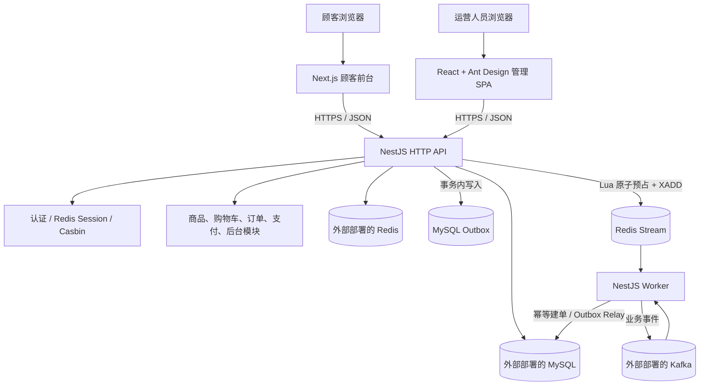

# 海外独立电商平台架构设计

> 状态：设计草案，供用户审阅。日期：2026-11-06。本文定义目标设计，不表示仓库中已有这些应用或实现。

## 1. 设计目标与依据

建设一个适合个人逐步实现、可用于面试演示的中美双市场独立电商项目。首期重点是顾客购物闭环、后台管理闭环、市场隔离授权，以及能够验证库存一致性的秒杀活动。

需求依据和优先级：

1. 用户在本轮确认的技术、市场、功能与交付决策优先。
2. 用户提供的《PRD：全栈电商平台（内置 AI 智能客服 Agent）.pdf》作为业务背景与原始需求来源。
3. 当 PRD 与用户在本轮明确的决策冲突时，采用本轮决策，并在下文标明被延后的范围。

因此，虽然原 PRD 有 AI 客服 Agent，本项目首期不实现 AI Agent；后续可单独评估。项目是完整的演示型电商，不作为可直接承接真实跨境交易的生产系统。

## 2. 已确认范围

| 领域 | 首期决定 |
| --- | --- |
| 市场 | 美国与中国；共用商品目录，按市场维护本地化内容、价格、库存与支付时限 |
| 语言与币种 | 英文/美元、简体中文/人民币；两市场售价独立维护，不按实时汇率换算 |
| 顾客前台 | Next.js |
| 管理后台 | React + Ant Design SPA |
| 服务端 | NestJS 模块化单体；HTTP API 与异步 Worker 分进程运行、共享业务模块 |
| 数据库与 ORM | MySQL + TypeORM，通过迁移管理数据库结构 |
| 缓存与活动准入 | Redis；秒杀采用 Lua + Redis Stream |
| 业务事件 | Kafka；MySQL Outbox Relay 发布已提交订单事件 |
| 权限 | Casbin RBAC + 市场 Domain 范围；权限点代码定义，后台分配角色与授权 |
| 认证 | 顾客邮箱 + 密码；管理员账号单独管理；Redis Session + HttpOnly Cookie |
| 支付 | 模拟支付，支持成功、失败、重试、超时关闭和重复回调处理 |
| 钱包 | 站内模拟余额；支持模拟充值、下单扣款、退款回余额和幂等流水 |
| 财务看板 | 后台按授权市场展示销售收入、商品成本和毛利；US/USD、CN/CNY 分开汇总 |
| 促销 | 首期仅秒杀；优惠券列入后续候选切片，满减等暂缓评估 |
| 压测 | 秒杀从 100 虚拟用户起步；普通下单另测热门 SKU 与最后一件库存争抢 |
| 基础设施 | MySQL、Redis、Kafka 由开发者单独部署；本地可用 Docker，NestJS 通过配置文件连接；商品图片上传到应用服务器持久目录 |
| 开发方式 | 单人开发，monorepo，按可运行的垂直切片推进 |

商品购物车不预占库存；顾客提交结账、系统生成待支付订单时才锁定普通库存。秒杀请求为了高并发防超卖，先由 Redis Lua 原子预占活动配额，再由 Worker 异步创建订单。

## 3. 系统上下文



NestJS API 和 Worker 属于同一模块化单体代码库中的不同运行进程。Kafka 用于已提交业务事件的异步扩展，不作为秒杀库存入口；Redis Stream 专门承接秒杀请求。

## 4. 仓库与运行边界

```text
apps/
  storefront/   # Next.js 顾客前台
  admin/        # React + Ant Design 管理 SPA
  api/          # NestJS HTTP API
  worker/       # NestJS Redis Stream / Outbox / Kafka worker
packages/
  contracts/    # 可共享的 API schema、类型与事件契约
  data-access/  # API 与 Worker 共用的 TypeORM 配置、实体和迁移
  shared/       # 少量跨应用共享代码
```

应用之间共享仓库和类型，不共享数据库访问边界。只有 `api` 与 `worker` 可以直接访问业务数据库；前端通过 HTTP API 获取或修改数据。MySQL、Redis、Kafka 独立部署，连接地址、用户名、密码、TLS/SASL 等从每个环境的配置注入。商品图片文件写入由 `MEDIA_STORAGE_DIR` 配置的服务器持久目录，图片访问使用配置的媒体基础 URL；多实例共享存储、CDN 与对象存储暂不纳入首期。真实凭据不提交仓库；提供不含秘密的配置示例。

本地 NestJS 进程直连 Docker 发布的端口时可使用 `127.0.0.1`；应用也在 Docker 网络中运行时应使用服务名。Kafka 客户端能连上 bootstrap broker 后，还必须能访问 broker 广播的 `advertised.listeners` 地址。

## 5. 业务模块

### 顾客端

- 商品目录、详情、搜索和市场/语言切换。
- 账户注册、登录、登出与密码重置流程。
- 购物车、收藏和最近浏览记录（按路线图分阶段实现）。
- 结账、模拟支付、订单查询、取消与售后入口。

### 后台端

- 管理员登录、账号管理、角色与权限分配。
- 商品、分类、本地化内容管理。
- US/CN 售价与市场库存管理。
- 订单、模拟支付/钱包状态、履约和售后处理。
- 秒杀活动、活动配额、支付时限配置。
- 财务看板：按授权市场查看销售收入、商品成本、毛利和退款数据。
- 管理操作审计与业务日志查询入口。

### 服务端模块

`Auth`、`Authorization`、`Catalog`、`Market`、`Inventory`、`Cart`、`Order`、`PaymentMock`、`Wallet`、`FinanceDashboard`、`AfterSales`、`Seckill`、`Admin`、`Outbox`、`Observability`。优惠券模块留到秒杀之后的候选切片。模块通过服务接口协作；领域用例和事务边界放在 NestJS 服务层，不放到 React 页面或控制器中。

## 6. 市场、商品与价格模型

- 共用商品主记录与 SKU；商品文案按 `market + locale` 保存。
- 市场实体至少包含 `US`、`CN`，明确默认语言和币种。
- 售价和商品成本由 `SKU + market + currency` 确定，金额使用整数最小货币单位保存（USD cents、CNY fen），订单行保存成交价和商品成本快照。
- 普通可售库存与秒杀活动配额分开。所有下单请求都绑定市场，服务端根据市场重新确定价格、可售性与库存，不信任客户端币种或金额。
- 缓存键包含市场和语言，避免 US/CN 的展示内容和价格互相污染。

### 商品管理和上架规则

- 一个共享商品有一个或多个 SKU。SKU 含唯一编码和规格属性（例如颜色/尺码）；首期由后台逐条维护 SKU，不实现规格笛卡尔积生成器。
- 商品基础数据、SKU 销售单元、按市场/语言维护的文案、市场上架状态、SKU 市场售价和市场库存分开管理。
- US 与 CN 分别发布、暂停或下架；操作人员只能管理 Casbin 授权的市场。
- 在某市场发布前，要求该市场已配置本地化标题、至少一个启用 SKU、每个可售 SKU 的市场售价和库存。条件不满足时阻止发布并指出缺项。
- 商品图片支持后台上传到应用服务器，或填写外部图片 URL。MySQL 仅保存媒体元数据和引用，不存二进制图片；首期只接受 JPEG、PNG、WebP，单张最大 5 MB；上传文件使用随机存储名，不能用原始文件名拼接服务器路径。
- 图片可关联商品市场详情或具体 SKU；美国与中国可复用同一媒体，必要时分别维护市场图片。上传 API 需执行管理员身份和市场范围校验。
- 商品停止销售使用下架/归档，不物理删除已有订单引用的数据。改价或库存调整记录操作人、市场、变更前后值和原因。
- 购物车只引用 `sku_id` 与数量。结账时重新读取该市场当前售价和库存；已有订单保留价格、币种和 SKU 描述快照。

建议核心实体：`users`、`admin_users`、`markets`、`products`、`product_translations`、`product_media`、`product_skus`、`product_market_prices`、`sku_market_costs`、`market_inventory`、`carts`、`cart_items`、`orders`、`order_items`、`payment_attempts`、`wallet_accounts`、`wallet_ledger_entries`、`seckill_campaigns`、`seckill_inventory`、`seckill_reservations`、`returns`、`roles`、`permissions`、`casbin_rule`、`outbox_events`、`admin_audit_logs`。实施时再按当前切片确定完整字段和索引，不提前冻结全量 schema。

## 7. 身份认证与权限

### 认证

- 顾客邮箱 + 密码注册登录；管理员账户不开放公开注册，由具备权限的管理员创建或初始化。
- 顾客和管理员身份数据分表，避免把顾客自助注册与后台管理权限混成一种身份来源。
- 使用 Redis Session 和 HttpOnly Cookie；Cookie 使用适当的 `Secure`、`SameSite` 设置，并对跨站请求实施 CSRF 防护。
- 角色权限和市场范围在服务端校验；Session 中不缓存长期有效的授权结论。登出、封禁或权限变更可撤销会话/立即生效。

### Casbin 与市场范围

- Casbin 在 NestJS 授权层执行规则，RBAC Domain 表示市场范围（例如 `US`、`CN`）。
- 权限点由代码稳定定义，如 `product.read`、`product.update`、`order.read`、`order.fulfill`、`seckill.manage`、`admin.role.manage`。
- 后台可管理角色、给角色分配代码定义的权限点、把管理员角色绑定到一个或多个市场；全局超级管理员可跨市场。
- Casbin 策略及角色元信息持久化到 MySQL。NestJS 更新策略后同步当前 Enforcer；多实例部署时再增加跨实例策略刷新机制。
- Casbin 决策不自动过滤 SQL 结果。服务层仍须把获准的 `market_id` 加入查询条件。顾客访问订单还需校验 `order.user_id = currentUser.id`。
- React 菜单和按钮按权限呈现仅是体验控制；最终授权始终由 API 强制执行。

## 8. 普通购物与订单状态

### 购物车与普通下单

1. 购物车只保存 SKU 和数量，不锁库存。
2. 提交结账时，服务端重新校验市场、商品状态、价格和数量。
3. 在一个 MySQL 事务中执行库存条件更新（可售量必须足够）、将库存转为预留、写订单和订单行、写支付截止时间快照、写 Outbox 事件。
4. 任一步失败则回滚；库存不足返回明确结果。下单接口使用幂等键，重复提交不生成重复订单。
5. 支付成功把预留库存转为已售；订单取消或未支付超时释放预留库存。释放操作幂等。

普通库存条件更新以 MySQL 为权威数据源，不经过 Redis 扣减。商品缓存可加速读，但结账前必须重新读取权威价格和库存。

### 订单和支付状态

订单履约状态与支付尝试分开管理：

```text
订单：PENDING_PAYMENT -> PAID -> PROCESSING -> SHIPPED -> DELIVERED
           |                                  |
           +-> CANCELLED                      +-> RETURN_REQUESTED -> REFUNDED

支付尝试：INITIATED -> SUCCEEDED | FAILED | EXPIRED
```

单次支付失败不必立即关闭订单，可重试至 `payment_deadline_at`。支付成功和超时关闭通过数据库状态条件/事务竞争，只有一方能完成迁移。已关闭订单的迟到支付回调不能把订单复活；记录异常并走模拟退款/人工处理流程。

每个市场由后台配置待支付时限，建议范围 5–120 分钟、默认 15 分钟。创建订单时计算并保存 `payment_deadline_at`；修改设置只影响新订单。后台修改记录审计日志。

### 站内钱包和财务看板

- 钱包为模拟资金，不接真实充值通道。账户按 `user + market + currency` 隔离，US/USD 与 CN/CNY 余额不能互转。
- 顾客可模拟充值。充值只增加钱包负债余额，不计入销售收入；所有充值、扣款、退款都写不可变 `wallet_ledger_entries`，不得直接改/删历史流水。
- 钱包支付在一个 MySQL 事务中检查余额、条件扣减账户余额、写唯一业务流水、标记支付成功/订单已支付并写 Outbox。余额不足不扣款，订单保持待支付，可先充值再重试。
- 退款经后台授权后幂等退回原市场/币种的钱包账户。重复支付或退款请求由唯一业务幂等键拦截；钱包余额不得为负。
- 管理员按市场配置每个 SKU 的商品成本价，使用市场币种记录；订单行保存成本快照，之后改成本不回算历史订单。
- 首期财务口径：销售收入 = 已支付订单金额减退款；商品成本 = 对应已售 SKU 的成本快照；毛利 = 销售收入减商品成本。模拟充值不是销售收入。运费、广告、税费、支付手续费和运营费用暂不计入。
- 看板按 US/USD 或 CN/CNY 单独显示，不把美元和人民币直接相加；用户权限限制可见市场。

超时 Worker 按 `PENDING_PAYMENT + payment_deadline_at` 索引批量扫描。锁定订单或使用条件状态迁移，在同一 MySQL 事务关闭订单、释放库存并写 Outbox；重复任务无副作用。秒杀活动库存释放另走可重试、幂等补偿。

## 9. 秒杀、Redis Stream 与库存补偿

### 配额划分

秒杀活动开始前，在 MySQL 事务中从市场普通可售库存划出活动配额，避免普通下单和秒杀共用同一可售份额。活动期间冻结配额调整规则；未使用配额在活动结束时可归还市场库存。

### 秒杀请求流程

1. API 校验登录身份、市场、活动状态和基本参数。
2. Redis Lua 脚本原子执行活动库存判断、用户限购判断、配额预占、预占记录和 `XADD` 写入 Redis Stream。
3. 只在脚本成功写入 Stream 后返回“排队中”；重复请求返回同一个幂等结果或明确的重复购买拒绝。
4. NestJS Worker 以 Consumer Group 消费 Stream，幂等地在 MySQL 事务中持久化预占和 `PENDING_PAYMENT` 订单，事务提交后 `XACK`。
5. 前台通过订单/排队状态接口查询最终结果。Worker 失败消息保留待处理并按退避策略重试；超过重试上限进入可运维的死信/人工补偿状态。
6. 订单支付、取消或超时通过 MySQL Outbox 驱动幂等的 Redis 活动配额确认或释放；补偿重试直到对账一致。

MySQL 是订单、支付与持久库存事实源；Redis Lua 是秒杀高并发入口的原子闸门。Redis 不可用时暂停秒杀入口，不允许降级为绕过限购的直接建单。

## 10. Kafka 与 Outbox

- 订单事务同时写 `outbox_events`，事件和业务数据同库同事务提交。
- Relay Worker 读取未发布事件并发布到 Kafka；发布成功后标记状态。Relay 崩溃可能产生重复发布，因此事件含稳定 `event_id`，消费者按 ID 幂等。
- 首期事件可包括 `OrderCreated`、`PaymentSucceeded`、`OrderCancelled`、`RefundCompleted`；至少实现一个消费者（模拟通知或运营统计）。
- Kafka 不承担秒杀准入、库存扣减或 HTTP 同步 RPC。Stream 与 Kafka 各有独立职责。
- 监控发布失败、重试数、Outbox backlog、Kafka consumer lag；告警和死信处理在实现切片中定义。

## 11. Redis 读缓存与三类问题

Cache-Aside 用于商品详情、目录和本地化展示数据；键至少含市场、语言、商品/SKU 标识。下单时重新校验 MySQL 权威值。

| 问题 | 首期处理 |
| --- | --- |
| 缓存穿透 | 参数与市场校验；对确定不存在的商品缓存短 TTL 空值；数据库错误不缓存；布隆过滤器暂不引入 |
| 缓存击穿 | 热点数据逻辑过期/单飞重建；一个请求回源刷新，其余读短期旧值或短暂等待；热点商品可预热 |
| 缓存雪崩 | TTL 加随机抖动、分批预热、数据库连接池上限和回源限流/熔断 |

商品更新先提交 MySQL，再失效相关键；TTL 作为兜底。Redis 读缓存不可用时普通查询受控回源；秒杀 Redis 闸门不可用时关闭秒杀入口。

## 12. 购物车、售后和顾客留存路线

- **普通购物闭环**：购物车、结账、订单、模拟支付、发货与订单查询。
- **售后切片**：已支付未发货取消与模拟退款；之后增加退货申请、后台审核和退款状态。
- **顾客留存切片**：收藏商品、最近浏览商品记录。

已支付订单退款状态与订单履约状态分别记录。退货具体规则（可退期限、是否要求退回入库、部分退款等）在售后切片启动前设计，不在首期预设复杂规则。

## 13. 日志、审计与指标

- 结构化应用日志包含 `requestId`、`userId`（可为空）、`marketId`、`orderId`、`activityId`、错误类别、耗时和结果；敏感字段脱敏。
- 后台审计记录管理员、市场范围、动作、实体、结果及必要变更摘要，覆盖改价、库存调整、角色授权、支付时限、秒杀活动、订单履约和退款审批。
- 业务指标：接口 P95/错误率、普通下单成功/库存不足数、秒杀排队接受/拒绝数、库存差异、Stream pending/lag、Kafka lag、Outbox backlog、DB 连接池。
- 日志和审计不能替代 API 权限校验；不得记录密码、Cookie、令牌或凭据。

## 14. 测试策略与验收

| 测试层 | 主要范围 |
| --- | --- |
| 单元 | 价格/市场规则、订单和支付状态迁移、超时与退款规则、Casbin 授权决策 |
| 集成 | TypeORM 事务、条件扣库存、Lua 原子限购、Stream 重复投递/恢复、Outbox/Kafka 重试、Session 撤销 |
| E2E | 顾客浏览→购物车→下单→模拟支付→订单履约；后台授权、市场隔离、商品图片上传/URL、库存与支付时限设置 |
| 并发/压测 | 普通热门 SKU 和最后一件库存；秒杀 100 虚拟用户；消息积压、Worker 重启与补偿 |

首期正确性硬门槛：零超卖、限购有效、重复下单幂等、已接受秒杀请求最终进入已建单或明确失败终态、消息可恢复、释放不重复加库存、US/CN 无越权读写。

秒杀“已排队”响应 P95 ≤ 1 秒是当前建议的本地压测目标，尚未单独得到用户确认；最终报告需注明机器、数据规模、运行配置、吞吐、P95/P99、错误率、Stream/Kafka lag 和 MySQL 负载。该指标不等同生产 SLA。

## 15. 渐进式实现路线

1. **基础工程与账号权限**：monorepo、环境配置、健康检查、TypeORM migrations、日志骨架、邮箱密码登录、Redis Session、Casbin 与市场范围。
2. **商品与后台管理**：共用目录、本地化内容、市场价格/库存、支付时限后台设置、缓存策略。
3. **普通订单闭环**：购物车、建单时普通库存预留、模拟充值与钱包支付/退款、超时关闭、取消/发货、市场财务看板、Outbox 落表和 E2E。
4. **秒杀一致性**：活动配额、Lua + Stream、Worker、幂等、补偿和并发测试。
5. **Kafka 与压测**：Outbox Relay、业务事件消费者、可观测指标、普通下单和 100 VU 秒杀报告。
6. **售后与留存**：退款/退货、收藏、最近浏览；逐功能增加测试和后台流程。
7. **优惠券候选切片**：秒杀稳定后实现按市场配置的固定金额券/折扣比例券、最低消费、有效期和总量/每人限额；不与秒杀叠加。创建待支付订单时预留核销次数，支付后确认，取消/超时幂等释放。

每个切片先实现可运行的端到端最小功能，再扩展错误处理、日志和自动化测试；不提前生成未开工模块的大量空架构。

## 16. 首期明确不做

AI 客服 Agent、真实支付/充值通道、实时汇率、优惠券首期实现、满减、真实物流商接入、税费与关税计算、多商家、多仓、欺诈风控、生产级多机高可用。钱包充值、扣款和退款均为模拟资金；优惠券列为秒杀后的候选切片，规则已作高层确认，切片启动时再设计具体校验与接口；退款在售后切片中使用模拟状态演示。

## 17. 待实现前确认/校准

- 100 VU 秒杀的 P95 ≤ 1 秒作为演示压测目标，最终是否采用及机器基线待审阅时确认。
- 退货期限、退回入库和部分退款规则留到售后切片启动前确定。
- Kafka Topic 分区数、保留时间、重试/死信策略根据实际部署与首个消费者切片细化。
- Casbin 策略多实例热刷新仅在 API 横向扩容时设计；单实例首期由应用服务更新 Enforcer。
- MySQL/Redis/Kafka 具体镜像版本、账号权限、网络监听与数据卷由本地运行配置固定；不把秘密写入版本控制。

## 自检记录

- 当前决定一致：前台 Next.js、后台 React SPA、NestJS 模块化单体、MySQL/TypeORM、Redis、Kafka、Casbin、邮箱登录、Redis Session、市场范围授权。
- 普通下单库存只在建单事务中由 MySQL 预留；秒杀有独立活动配额并先经 Lua 原子闸门。
- 购物车不锁库存；支付超时和取消可释放；支付失败可重试；迟到回调不会复活已关闭订单。
- Outbox 和 Kafka 不与 Redis Stream 混为同一秒杀队列；消费者重复投递按幂等处理。
- 用户请求的 AI Agent 已从首期移除；购物车、售后、收藏和浏览记录按确认的阶段路线安排。
- 商品支持多 SKU；后台逐条维护 SKU，并按市场独立发布，发布校验已补入本文。
- 商品图片首期支持服务器持久目录上传和外部 URL 引用；MySQL 保存媒体元数据，不存图片二进制。
- 图片上传约束已确认：JPEG、PNG、WebP，单张最大 5 MB。
- 后续优惠券按市场配置，支持固定金额/百分比、门槛、期限、使用次数限制；不叠加秒杀，订单预留与支付/取消状态关联。
- 站内钱包支持模拟充值、订单扣款和退款回余额；财务看板按市场币种分别统计净销售收入、SKU 成本快照和毛利，钱包充值不计收入。
- 100 VU 已确认，P95 数值仍是建议目标，明确留待用户审阅。
- 尚无实现代码或运行测试结果；本文是目标设计与后续验收依据。
